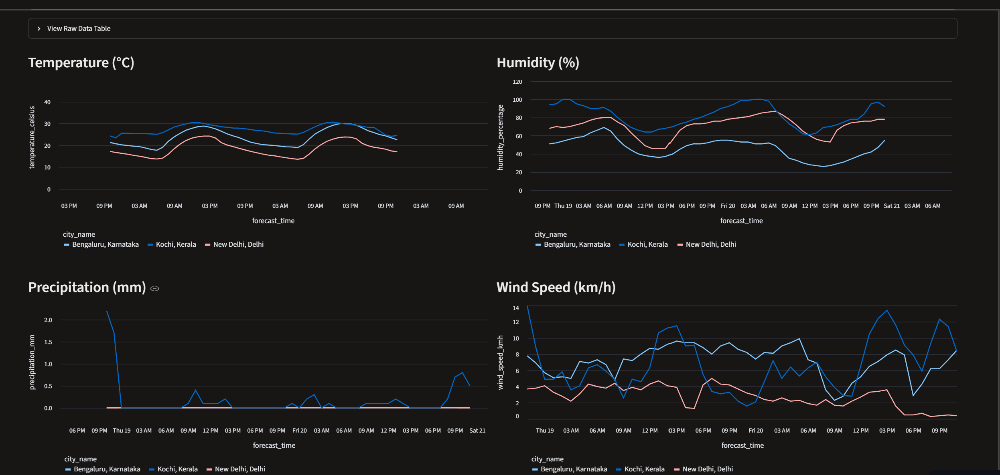
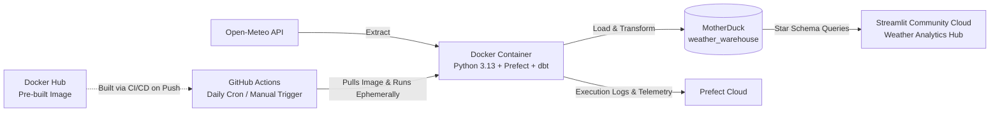
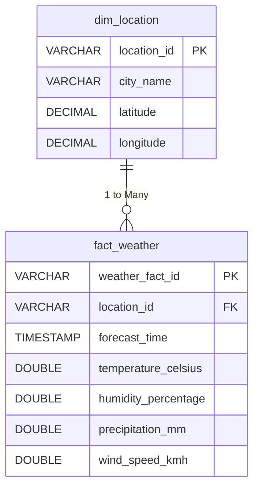
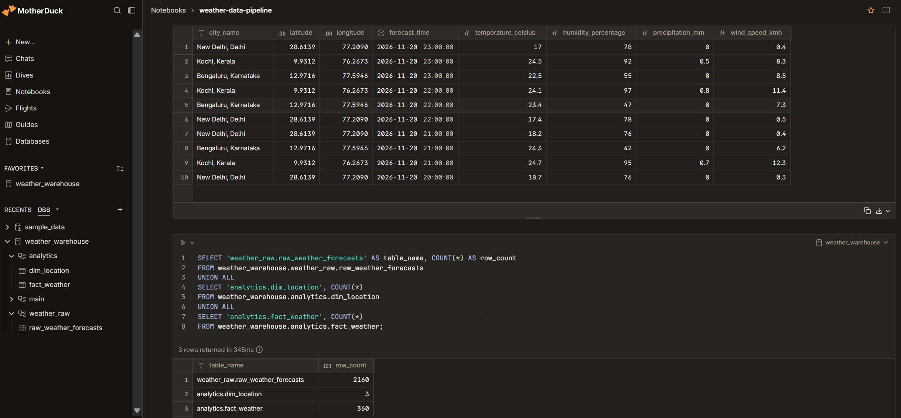
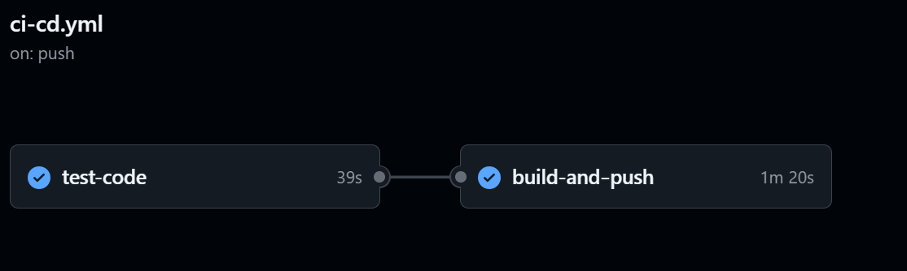
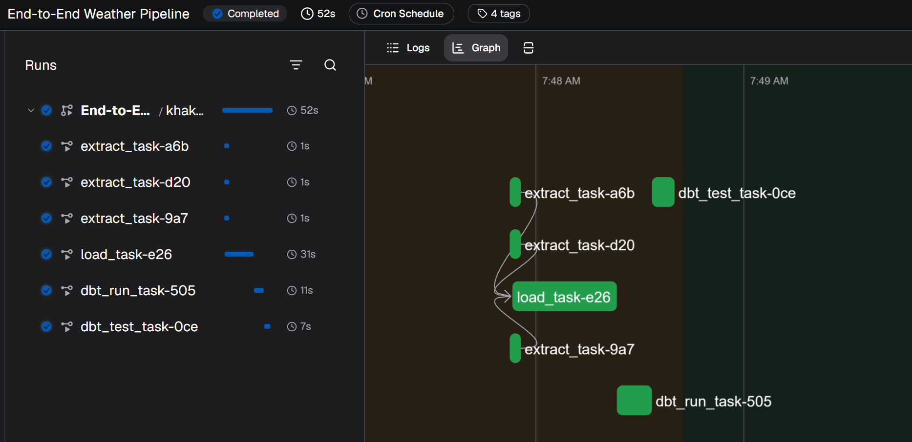

# 🌤️ End-to-End Weather Data Pipeline (DuckDB & MotherDuck)

An automated, serverless ELT data pipeline that extracts weather forecast data from the Open-Meteo API, models it into a Star Schema using **dbt** on **MotherDuck (Cloud DuckDB)**, orchestrates and monitors runs with **Prefect Cloud**, and visualizes forecast trends on **Streamlit Community Cloud**.

Built with **serverless and free-tier services, subject to their quotas**—decoupling CI/CD builds from scheduled execution using ephemeral GitHub Actions runners and Docker containers, eliminating the need for an idle 24/7 virtual machine.

[](https://github.com/roshy1234/weather-data-pipeline-duckdb/actions/workflows/ci-cd.yml)
[](https://github.com/roshy1234/weather-data-pipeline-duckdb/actions/workflows/run_pipeline.yml)


🔗 **Live Dashboard:** [Weather Analytics Hub](https://weather-data-pipeline-duckdb.streamlit.app)



---

## 🏗️ Architecture



### Key Architectural Highlights
* **Decoupled Build vs. Execution (CI/CD):** One GitHub Actions workflow lints code (`flake8`), builds the Docker image, and pushes it to Docker Hub on every push/PR to `main` or version tag. A second workflow pulls that pre-built image on a daily cron schedule without checking out source code or reinstalling dependencies.
* **Ephemeral Serverless Compute:** Runs execute inside disposable `ubuntu-latest` containers via `docker run --rm`, running the Prefect flow once to completion and tearing down immediately to maintain zero infrastructure cost.
* **Centralized Observability:** Even though compute is ephemeral, injecting `PREFECT_API_URL` and `PREFECT_API_KEY` streams real-time task states, run durations, and error logs directly to Prefect Cloud.

---

## 🛠️ Tech Stack

| Layer | Technology | Role |
| :--- | :--- | :--- |
| **Data Source** | Open-Meteo API | Hourly weather forecast data |
| **Language** | Python 3.13 | Extraction, loading, and orchestration logic |
| **Orchestration & Monitoring** | Prefect & Prefect Cloud | Flow/task orchestration, retries, and run observability |
| **Transformation** | dbt | SQL transformations into dimensional analytics models |
| **Data Warehouse** | DuckDB / MotherDuck | Serverless analytical cloud database (`weather_warehouse`) |
| **Containerization** | Docker & Docker Hub | Reproducible runtime environment for pipeline execution |
| **CI/CD & Scheduling** | GitHub Actions | Automated linting (`flake8`), image publishing, and cron execution |
| **Visualization** | Streamlit | Interactive dashboard hosted on Streamlit Community Cloud |

---

## 🗄️ Data Model (Star Schema)

Data is transformed by dbt into the `analytics` schema following a **One-to-Many (1:N)** Star Schema pattern, separating static city metadata from high-volume time-series weather observations:



* **`analytics.dim_location`**: Stores one unique record per monitored city with coordinates (`DECIMAL(6,4)`).
* **`analytics.fact_weather`**: Stores timestamped weather measurements linked to `dim_location` via `location_id`.

<details>
<summary>📸 View Materialized Tables in MotherDuck</summary>



</details>

---

## 📊 Dashboard Features

The **Weather Analytics Hub** (Streamlit) connects directly to MotherDuck with connection caching (`@st.cache_resource`) and a 5-minute query TTL (`@st.cache_data(ttl=300)`):
* **Interactive Data Model Expander:** Renders the Star Schema ER diagram directly inside the app.
* **Raw Data Preview Expander:** Inspect the latest 150 joined records from `fact_weather` and `dim_location`.
* **Multi-City Metrics:** Side-by-side time-series line charts tracking **Temperature (°C)**, **Humidity (%)**, **Precipitation (mm)**, and **Wind Speed (km/h)**.

---

## 📂 Project Structure

```
weather-data-pipeline-duckdb/
├── .github/
│   └── workflows/
│       ├── ci-cd.yml              # CI/CD pipeline
│       └── run_pipeline.yml       # Scheduled & manual pipeline execution
├── sql/
│   └── 01_create_raw_table.sql    # Raw weather table setup
├── docs/                          # Project output screenshots
│   └──images/
│       ├── ci-cd-graph.png
│       ├── prefect-cloud-run.png
│       ├── streamlit_dashboard_graphs.png
│       └── weather-warehouse-motherduck.png
├── src/
│   └── weather_pipeline/
│       ├── ingestion.py           # Fetches weather API data
│       ├── loader.py              # Loads data into MotherDuck
│       └── orchestrator.py        # Prefect main flow entry point
├── streamlit_app/
│   ├── Dockerfile                 # Streamlit container specification
│   ├── app.py                     # Streamlit dashboard
│   └── requirements.txt           # Dashboard dependencies
├── weather_transform/
│   ├── analyses/
│   ├── macros/
│   │   ├── .gitkeep
│   │   └── generate_schema_name.sql
│   ├── models/
│   │   ├── marts/
│   │   │   ├── dim_location.sql
│   │   │   └── fact_weather.sql
│   │   ├── staging/
│   │   │   └── stg_hourly_weather.sql
│   │   ├── schema.yml
│   │   └── sources.yml
│   ├── seeds/
│   ├── snapshots/
│   ├── tests/
│   │   ├── .gitkeep
│   │   └── assert_no_duplicate_hours.sql
│   ├── dbt_project.yml
│   └── profiles.yml
├── .dockerignore
├── .gitignore
├── compose.yaml                   # Docker Compose configuration
├── Dockerfile                     # Pipeline worker container
├── LICENSE
├── README.md
└── requirements.txt               # Pipeline dependencies
```
---

## ⚙️ Environment Variables & Secrets

Create a local `.env` file for development, and add these keys under **GitHub Repository Settings → Secrets and variables → Actions** for automated runs:

| Variable | Description |
| :--- | :--- |
| `MOTHERDUCK_TOKEN` | Authentication token for MotherDuck (`md:weather_warehouse`) |
| `PREFECT_API_URL` | Prefect Cloud workspace API endpoint (`https://api.prefect.cloud/api/accounts/.../workspaces/...`) |
| `PREFECT_API_KEY` | Prefect Cloud API key for logging flow telemetry |
| `WEATHER_API_URL` | Open-Meteo forecast endpoint (`https://api.open-meteo.com/v1/forecast`) |
| `DOCKERHUB_USERNAME` | Docker Hub username |
| `DOCKERHUB_TOKEN` | Docker Hub access token |

---

## 🚀 Running Locally

### 1. Clone the Repository
```bash
git clone https://github.com/roshy1234/weather-data-pipeline-duckdb.git
cd weather-data-pipeline-duckdb
```
### 2. One-time MotherDuck setup

Before the first pipeline run, initialize the raw table in your MotherDuck
`weather_warehouse` database:

1. Open the MotherDuck SQL workspace and select `weather_warehouse`.
2. Run the SQL in [`sql/01_create_raw_table.sql`](./sql/01_create_raw_table.sql).

Before running this setup or the pipeline, make sure `MOTHERDUCK_TOKEN` and the
other required settings are configured as described in
[Environment Variables & Secrets](#-environment-variables--secrets).

This creates the `weather_raw` schema and the
`weather_raw.raw_weather_forecasts` table used by the pipeline. The script uses
`IF NOT EXISTS`, so it is safe to run again if needed.

Complete this setup once before running the pipeline locally or triggering its
GitHub Actions workflow.

### 3. Run the Pipeline via Python
```bash
python -m venv .venv
source .venv/bin/activate  # On Windows: .venv\Scripts\activate
pip install -r requirements.txt

# Execute the Prefect flow once
python src/weather_pipeline/orchestrator.py
```

### 4. Run via Docker (Matches GitHub Actions Production Run)
```bash
docker run --rm \
  --env-file .env \
  roshyjamz/weather-pipeline-worker:latest
```

### 5. Launch the Streamlit Dashboard
```bash
pip install -r streamlit_app/requirements.txt
streamlit run streamlit_app/app.py
```

---

## 🔄 Automated Workflows

1. **CI/CD (`Weather Pipeline CI/CD`)**
   *  **Trigger:** Push to `main` or version tags (`*.*.*`).
   *  **Actions:** Runs `flake8` syntax/undefined-name checks (`E9,F63,F7,F82`) on Python 3.13, then builds and pushes `:latest` and tagged images to Docker Hub.
2. **Scheduled Execution (`Daily Weather Pipeline Execution`)**
   *  **Trigger:** Daily cron or manual `workflow_dispatch` from the **Actions** tab.
   *  **Actions:** Pulls the latest Docker image, injects runtime secrets, runs `main_flow()`, streams logs to Prefect Cloud, and destroys the container upon exit.

### Pipeline Execution & Observability

| GitHub Actions (CI/CD) | Prefect Cloud (Run Telemetry) |
| :---: | :---: |
|  |  |